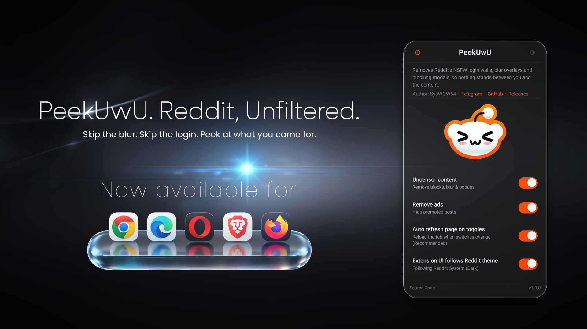

<!-- <div align="center"> -->

[](https://github.com/SysWOW64UwU/PeekUwU/releases) ·
[](https://github.com/SysWOW64UwU/PeekUwU/releases/latest/download/PeekUwU.zip) ·
[](https://github.com/SysWOW64UwU/PeekUwU/releases/latest/download/PeekUwU.xpi)

# PeekUwU

**View NSFW on Reddit without logging in!**

PeekUwU removes Reddit's blurry thumbnails, its "Log in to view" walls, and the
popups that block what you're trying to read. No account, no login, no waiting.



<details>
<summary>
<b>Watch PeekUwU in action!</b>
</summary>
<video src="./assets/PeekUwUDemo.mp4" controls autoplay loop playsinline>
</details>


[**⬇ Chrome**](https://github.com/SysWOW64UwU/PeekUwU/releases/latest/download/PeekUwU.zip) ·
[**⬇ Firefox**](https://github.com/SysWOW64UwU/PeekUwU/releases/latest/download/PeekUwU.xpi) ·
[**⬇ Userscript**](https://github.com/SysWOW64UwU/PeekUwU/releases/latest/download/peekuwu.user.js)

<!-- </div> -->

---

## What does PeekUwU do?

- **Removes the "Log in to view" walls** that interrupt every NSFW page
- **Un-blurs thumbnails, images and videos**, so you can actually see them
- **Hides ads** and promoted posts
- Works on desktop Reddit and the mobile site — **including Firefox on Android**

---

## Which one should I download?

They're all the same tool. Pick the row that matches your browser.

| If you use… | Download | Updates itself? |
| --- | --- | --- |
| **Firefox on Desktop** | [`PeekUwU.xpi`](https://github.com/SysWOW64UwU/PeekUwU/releases/latest/download/PeekUwU.xpi) | **Yes**, automatically |
| **Firefox on Android** | [`PeekUwU.xpi`](https://github.com/SysWOW64UwU/PeekUwU/releases/latest/download/PeekUwU.xpi) | **Yes**, automatically |
| **Tampermonkey / Violentmonkey** | [`peekuwu.user.js`](https://github.com/SysWOW64UwU/PeekUwU/releases/latest/download/peekuwu.user.js) | **Yes**, automatically |
| **Chrome, MS Edge, Opera, Brave, etc.** | [`PeekUwU.zip`](https://github.com/SysWOW64UwU/PeekUwU/releases/latest/download/PeekUwU.zip) | No — you update it yourself |

---

## Installing on Firefox

The easiest one.

1. [**Download PeekUwU.xpi**](https://github.com/SysWOW64UwU/PeekUwU/releases/latest/download/PeekUwU.xpi)
2. Double-click the file (or drag it onto a Firefox window)
3. Click **Add**

Firefox keeps it updated from then on.

**Older Firefox?** The `.xpi` needs **Firefox 140 or newer**, which rules out
Windows 7 / 8 / 8.1 (capped at ESR 115). Use the [userscript](#userscript-tampermonkey--violentmonkey)
instead — it works on any browser and needs no signing.

---

## Installing on Firefox for Android

Same `.xpi`, same download. Installing it on a phone takes a couple of extra
steps because Firefox hides the installer behind a secret menu.

**You need Firefox 142 or newer** — check under **⋮ → Settings → About Firefox**.
Older versions can't run this version of the add-on and will refuse to install it.

1. [**Download PeekUwU.xpi**](https://github.com/SysWOW64UwU/PeekUwU/releases/latest/download/PeekUwU.xpi)
   on your phone — open the link in Firefox and it will save to your downloads.
2. Open **⋮ → Settings → About Firefox**
3. **Tap the Firefox logo 5 times** quickly to unlock the developer menu
4. Go back to **⋮ → Settings** and scroll to the bottom
5. Tap **Install Extension from File**
6. Pick the `PeekUwU.xpi` you downloaded, then tap **Add**

Once installed, PeekUwU updates itself like it does on desktop.

**To open the settings menu:** **⋮ → Extensions**, then tap **PeekUwU**.

Everything works the same as on desktop.

---

## Installing on Chrome

Chrome doesn't install extensions from outside its store by default, so there's a
one-time switch to turn on first. Takes about a minute.

1. [**Download PeekUwU.zip**](https://github.com/SysWOW64UwU/PeekUwU/releases/latest/download/PeekUwU.zip)
   and extract it. You'll get a folder called `PeekUwU` — **don't rename it.**
2. Open **`chrome://extensions`**
3. Turn on **Developer mode** (switch, top-right)
4. Click **Load unpacked**
5. Choose the `PeekUwU` folder
6. Pin PeekUwU via the puzzle-piece icon in Chrome's toolbar

**Keep the folder.** Chrome loads the extension from that exact spot, so moving or
deleting it breaks the install. **Install only from this page** — a browser
extension can read the pages you visit.

---

## Userscript (Tampermonkey / Violentmonkey)

Works in any browser, including Incognito, with no separate extension to install.

1. Install [Tampermonkey](https://www.tampermonkey.net/) or
   [Violentmonkey](https://violentmonkey.github.io/)
2. [**Open peekuwu.user.js**](https://github.com/SysWOW64UwU/PeekUwU/releases/latest/download/peekuwu.user.js)
3. Click **Install**

No settings to configure, and your userscript manager keeps it updated.

---

## Using PeekUwU in Incognito Mode

Browsers **do not** let extensions into private windows until you explicitly allow
it.

**Chrome / Edge**
1. Open `chrome://extensions`
2. Find **PeekUwU** and turn on **Allow in Incognito**

**Firefox**
1. Open `about:addons`
2. Find **PeekUwU** and turn on **Run in Private Windows**

Then open a Reddit private window and it works like any other.

---

## How do I update?

- **Firefox** (desktop and Android) — nothing to do.
- **Userscript** — nothing to do.
- **Chrome** — download the newest `PeekUwU.zip`, extract it **over** your existing
  `PeekUwU` folder, then hit **↻** on its card in `chrome://extensions`.

Every version is kept on the [releases page](https://github.com/SysWOW64UwU/PeekUwU/releases).

---

## Questions people actually ask

**How do I view NSFW on Reddit without logging in?**<br>
Install PeekUwU and browse normally. The "Log in to view" gate, the blurred
thumbnails, and the age-verification popups get removed automatically. You never
need an account.

**How do I bypass the "Mature Content" wall in Incognito Mode?**<br>
Install PeekUwU, then allow it in private browsing — the browser blocks that by default:

- **Chrome:** `chrome://extensions` → PeekUwU → **Allow in Incognito**
- **Firefox:** `about:addons` → PeekUwU → **Run in Private Windows**

**How do I allow NSFW posts on Reddit?**<br>
PeekUwU has no content filter to configure — it doesn't hide anything, it only
removes the walls Reddit puts in front of public posts. If you're still seeing a
wall after installing, check the item above about Incognito permission, and confirm
you're on the newest version.

**Does PeekUwU remove ads?**<br>
Yes — use the optional toggle to remove promoted ads.

**Is it safe? Is my browsing data sent anywhere?**<br>
PeekUwU makes **no network requests at all**, no analytics, no tracking. 
It only changes Reddit pages in the browser you're already looking at.
The only things it saves are your own toggle choices, which stay on your machine.

**Does it work on my phone?**<br>
Yes, on Firefox for Android 142 and newer. It's the same `.xpi` you'd download on a
computer — see [Installing on Firefox for Android](#installing-on-firefox-for-android).

**Does it ask for scary permissions?**<br>
Very few, and no blanket access to your browsing. PeekUwU shows one permission
warnings about reading a browser setting — PeekUwU only *reads*
that setting to match your colours, it never writes to it.

**Something not working?**<br>
- Make sure you're on the newest version
- PeekUwU only touches Reddit — it does nothing on other sites, by design
- In Incognito? Check you enabled it (above)
- Check it's switched on in `chrome://extensions` or `about:addons`
- Still stuck? [Open an issue](https://github.com/SysWOW64UwU/PeekUwU/issues) —
  include your browser and version

---

## Author

**SysWOW64** · [Telegram](https://t.me/C3R741NLY_1MPR3551V3) ·
[GitHub](https://github.com/SysWOW64UwU/)

## License

[WTFPL](LICENSE) — do what the fuck you want.

---

<details>
<summary><b>For developers</b></summary>

Build, architecture, and the reasoning behind it:
[**DEVELOPMENT.md**](DEVELOPMENT.md).

```sh
node build.js && node scripts/verify-build.js
```

</details>